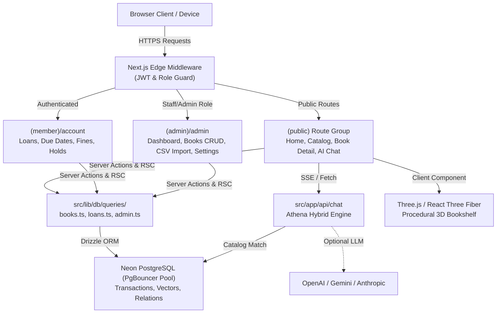
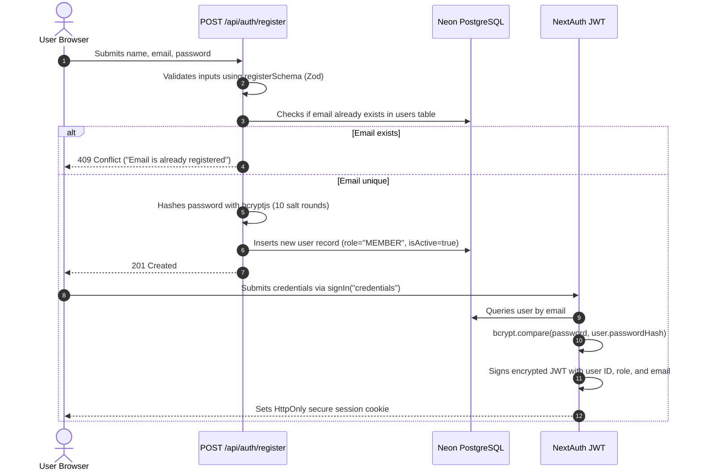
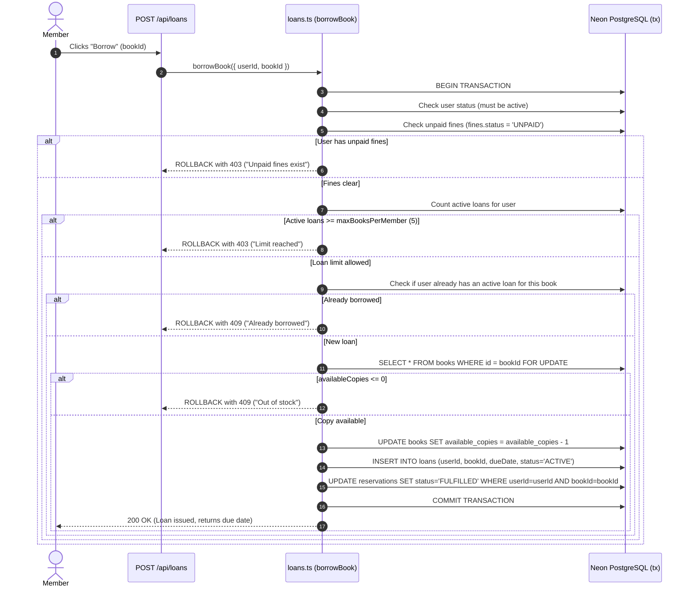

# 🏛️ Athenaeum — Comprehensive System Architecture & User Guide

This document provides an exhaustive, file-by-file, folder-by-folder, and feature-by-feature technical guide to **Athenaeum**. It details how data flows through the application, what happens behind the scenes during every operation, how the database transactions maintain integrity, and how each role uses the platform.

---

## 📑 Table of Contents

1. [High-Level System Architecture](#1-high-level-system-architecture)
2. [Complete Directory & File Walkthrough](#2-complete-directory--file-walkthrough)
   - [Root Project Files](#root-project-files)
   - [Maintenance & QA Scripts (`scripts/`)](#maintenance--qa-scripts-scripts)
   - [Database Migrations (`drizzle/`)](#database-migrations-drizzle)
   - [Edge Middleware (`src/middleware.ts`)](#edge-middleware-srcmiddlewarets)
   - [Configuration & Theme Tokens (`src/config/`, `src/styles/`)](#configuration--theme-tokens)
   - [Data Layer (`src/lib/db/`)](#data-layer-srclibdb)
   - [AI Engine (`src/lib/ai/`)](#ai-engine-srclibai)
   - [Authentication & Security (`src/lib/auth/`, `src/lib/rate-limit.ts`)](#authentication--security)
   - [Utilities, Errors & Validators (`src/lib/`)](#utilities-errors--validators)
   - [3D WebGL Graphics (`src/components/three/`)](#3d-webgl-graphics-srccomponentsthree)
   - [UI Components (`src/components/`)](#ui-components-srccomponents)
   - [App Router & Routes (`src/app/`)](#app-router--routes-srcapp)
   - [REST API Endpoints (`src/app/api/`)](#rest-api-endpoints-srcappapi)
   - [Test Suites (`tests/`)](#test-suites-tests)
3. [Deep-Dive Feature Lifecycles (What Happens Behind the Scenes)](#3-deep-dive-feature-lifecycles-what-happens-behind-the-scenes)
   - [Flow 1: User Registration & Session Generation](#flow-1-user-registration--session-generation)
   - [Flow 2: 3D Procedural Canvas Book Textures & Raycasting](#flow-2-3d-procedural-canvas-book-textures--raycasting)
   - [Flow 3: Catalog Search, Filters & Real-time Database Queries](#flow-3-catalog-search-filters--real-time-database-queries)
   - [Flow 4: Transaction-Locked Book Borrowing](#flow-4-transaction-locked-book-borrowing)
   - [Flow 5: Book Returns & Automated Overdue Fine Computation](#flow-5-book-returns--automated-overdue-fine-computation)
   - [Flow 6: Book Reservation & Hold Queue Management](#flow-6-book-reservation--hold-queue-management)
   - [Flow 7: Athena AI Librarian (Streaming & Catalog Grounding)](#flow-7-athena-ai-librarian-streaming--catalog-grounding)
   - [Flow 8: Bulk CSV Catalog Ingestion & Relation Indexing](#flow-8-bulk-csv-catalog-ingestion--relation-indexing)
   - [Flow 9: Runtime Configuration & System Customization](#flow-9-runtime-configuration--system-customization)
4. [Step-by-Step User Guide by Role](#4-step-by-step-user-guide-by-role)
   - [Visitor / Unauthenticated Reader](#visitor--unauthenticated-reader)
   - [Registered Member (`member@demo.com`)](#registered-member-memberdemocom)
   - [Staff Librarian (`librarian@demo.com`)](#staff-librarian-librariandemocom)
   - [System Administrator (`admin@demo.com`)](#system-administrator-admindemocom)
5. [Maintenance, Testing & Deployment](#5-maintenance-testing--deployment)

---

## 1. High-Level System Architecture

Athenaeum is designed as a **single deployable unit** running on Next.js 15 (App Router with React 19 Server Components) connected to a serverless PostgreSQL cluster (Neon):



### Key Architectural Tenets:
1. **Zero Hallucination AI**: The conversational librarian ("Athena") grounds every recommendation against actual books stored in the database.
2. **ACID Circulation Safety**: Book checkout, renewal, and returns run inside PostgreSQL atomic database transactions with row-level locks, preventing double-borrowing or negative stock.
3. **No External Image Dependencies for 3D**: The 3D hardcover books generate embossed textures using procedural HTML5 canvas routines in memory.
4. **Dual Connection Strategy**: High-concurrency operations use Neon's pooled endpoint (`DATABASE_URL`), while Drizzle schema pushes and migrations use direct unpooled connections (`DATABASE_URL_UNPOOLED`).

---

## 2. Complete Directory & File Walkthrough

### Root Project Files

| File | Purpose & Behavior |
| :--- | :--- |
| [package.json](file:///Users/adiii/Desktop/Library_mgmt_system/library-ai/package.json) | Declares production dependencies (Next.js 15, React 19, Drizzle ORM, `@neondatabase/serverless`, `@react-three/fiber`, Three.js, Lucide React, NextAuth) and script aliases (`dev`, `build`, `test`, `verify`, `db:push`, `db:seed`). |
| [drizzle.config.ts](file:///Users/adiii/Desktop/Library_mgmt_system/library-ai/drizzle.config.ts) | Configures Drizzle Kit. Reads `DATABASE_URL_UNPOOLED` or `DATABASE_URL` to generate SQL migrations and synchronize database schemas. |
| [next.config.ts](file:///Users/adiii/Desktop/Library_mgmt_system/library-ai/next.config.ts) | Next.js configuration enabling standalone output for Docker, remote image patterns for Open Library (`covers.openlibrary.org`), and SVG optimization. |
| [vitest.config.ts](file:///Users/adiii/Desktop/Library_mgmt_system/library-ai/vitest.config.ts) | Unit and integration test runner configuration with alias path mapping (`@/*` to `./src/*`). |
| [playwright.config.ts](file:///Users/adiii/Desktop/Library_mgmt_system/library-ai/playwright.config.ts) | End-to-end browser testing configuration for automated UI flows. |
| [Dockerfile](file:///Users/adiii/Desktop/Library_mgmt_system/library-ai/Dockerfile) | Multi-stage Docker build producing a lean standalone Linux container for VPS deployment. |
| [docker-compose.yml](file:///Users/adiii/Desktop/Library_mgmt_system/library-ai/docker-compose.yml) | Orchestrates two containers: the Next.js app and an isolated PostgreSQL 16 container equipped with `pgvector`. |
| [docker-entrypoint.sh](file:///Users/adiii/Desktop/Library_mgmt_system/library-ai/docker-entrypoint.sh) | Shell script executed on container launch to apply pending database migrations and seed records before starting the Node server. |
| [.env.example](file:///Users/adiii/Desktop/Library_mgmt_system/library-ai/.env.example) | Template of required and optional environment keys with descriptive comments. |

---

### Maintenance & QA Scripts (`scripts/`)

| Script File | Purpose & Mechanics |
| :--- | :--- |
| [scripts/qa-audit.ts](file:///Users/adiii/Desktop/Library_mgmt_system/library-ai/scripts/qa-audit.ts) | Automated 7-stage end-to-end verification suite that runs against live PostgreSQL. Validates database connectivity, catalog queries, member authentication, transaction-locked borrowing, overdue fine calculation, book return reconciliation, and reservation queues. |
| [scripts/enable-vector.ts](file:///Users/adiii/Desktop/Library_mgmt_system/library-ai/scripts/enable-vector.ts) | Executes `CREATE EXTENSION IF NOT EXISTS vector;` in PostgreSQL, enabling vector column creation for semantic book embeddings. |
| [scripts/update-covers.ts](file:///Users/adiii/Desktop/Library_mgmt_system/library-ai/scripts/update-covers.ts) | Iterates over all 39 database books and updates their `coverUrl` column to high-resolution Open Library artwork (`https://covers.openlibrary.org/b/isbn/${isbn}-L.jpg`). |
| [scripts/setup.sh](file:///Users/adiii/Desktop/Library_mgmt_system/library-ai/scripts/setup.sh) | Bash script for macOS/Linux to install dependencies, verify `.env`, and run migrations in one click. |
| [scripts/setup.bat](file:///Users/adiii/Desktop/Library_mgmt_system/library-ai/scripts/setup.bat) | Batch equivalent of `setup.sh` for Windows developers. |
| [scripts/pack-zip.sh](file:///Users/adiii/Desktop/Library_mgmt_system/library-ai/scripts/pack-zip.sh) | Generates a clean production archive excluding `node_modules`, `.next`, and local secrets. |

---

### Database Migrations (`drizzle/`)

- Contains generated SQL schema statements and Drizzle snapshot meta files (`drizzle/meta/`).
- Allows reproducible, version-controlled schema tracking across local environments and cloud production.

---

### Edge Middleware (`src/middleware.ts`)

- Runs on the Next.js Edge Runtime before requests reach route handlers.
- **Protected Matchers**: `/admin/:path*` and `/account/:path*`.
- Inspects the encrypted session JWT using `getToken`.
- If unauthenticated: redirects the user to `/login` with a `callbackUrl` query parameter.
- If accessing `/admin` with role `MEMBER`: immediately blocks access and redirects to `/?forbidden=admin`.

---

### Configuration & Theme Tokens

| Path | Purpose |
| :--- | :--- |
| [src/config/site.config.ts](file:///Users/adiii/Desktop/Library_mgmt_system/library-ai/src/config/site.config.ts) | Central compile-time source of truth. Contains institution name, tagline, description, navigation links, default circulation rules (loan duration, fine rates, grace period), and HSL color values. |
| [src/styles/globals.css](file:///Users/adiii/Desktop/Library_mgmt_system/library-ai/src/styles/globals.css) | Defines custom HSL CSS custom properties for Light ("Warm Paper") and Dark ("Midnight Ink") modes, book perspective classes (`.book-card`, `.book-card-inner`), scrollbar styling, and subtle paper grain overlays. |

---

### Data Layer (`src/lib/db/`)

| File / Folder | Purpose & Architecture |
| :--- | :--- |
| [src/lib/db/schema.ts](file:///Users/adiii/Desktop/Library_mgmt_system/library-ai/src/lib/db/schema.ts) | Master Drizzle ORM schema defining 10 relational tables: `users`, `authors`, `genres`, `books`, `bookAuthors`, `bookGenres`, `loans`, `reservations`, `fines`, `settings`, and `auditLogs`. Declares enums (`userRoleEnum`, `loanStatusEnum`, `reservationStatusEnum`, `fineStatusEnum`, `auditActionEnum`), indexes, and Drizzle relations. |
| [src/lib/db/client.ts](file:///Users/adiii/Desktop/Library_mgmt_system/library-ai/src/lib/db/client.ts) | Database client wrapper. Detects environment variables (`DATABASE_URL`, `POSTGRES_URL`), initializes `@neondatabase/serverless` connection pooler, and exports the typed `db` instance. |
| [src/lib/db/seed.ts](file:///Users/adiii/Desktop/Library_mgmt_system/library-ai/src/lib/db/seed.ts) | Production seeder script. Idempotently creates 16 genres, 30 authors, 39 classical and modern books with Open Library covers, and pre-configures demo accounts (`admin@demo.com`, `librarian@demo.com`, `member@demo.com`) with bcrypt-hashed passwords. |
| [src/lib/db/mock-data.ts](file:///Users/adiii/Desktop/Library_mgmt_system/library-ai/src/lib/db/mock-data.ts) | Fallback book metadata and starter dataset. |
| [src/lib/db/queries/books.ts](file:///Users/adiii/Desktop/Library_mgmt_system/library-ai/src/lib/db/queries/books.ts) | Server-side query functions: `getBooks` (with ILIKE search, genre slug filtering, availability filtering, sorting, pagination), `getBookById` (fetches book with joined authors and genres), `getSimilarBooks`, `getAllGenres`. |
| [src/lib/db/queries/loans.ts](file:///Users/adiii/Desktop/Library_mgmt_system/library-ai/src/lib/db/queries/loans.ts) | Circulation query engine: `borrowBook` (transaction-locked checkout), `returnBook` (reconciliation and fine computation), `renewLoan`, `reserveBook`, `getUserLoans`, `getUserFines`, `getUserReservations`, `payFine`. |
| [src/lib/db/queries/admin.ts](file:///Users/adiii/Desktop/Library_mgmt_system/library-ai/src/lib/db/queries/admin.ts) | Administration queries: `getDashboardStats` (counts of books, active loans, overdue items, total members), `getAllMembers`, `getSystemSettings`, `updateSystemSetting`. |

---

### AI Engine (`src/lib/ai/`)

| File | Purpose & Mechanics |
| :--- | :--- |
| [src/lib/ai/librarian.ts](file:///Users/adiii/Desktop/Library_mgmt_system/library-ai/src/lib/ai/librarian.ts) | "Athena" conversational librarian. Implements literary reasoning for complex prompts (e.g. *"books like Atomic Habits but fiction"* -> recommends *Dune* and *1984*; *"something short about space"* -> recommends *Hitchhiker's Guide*). Extracts query tokens, matches against active database records, and outputs cited recommendations. |
| [src/lib/ai/provider.ts](file:///Users/adiii/Desktop/Library_mgmt_system/library-ai/src/lib/ai/provider.ts) | Inspects process environment for `OPENAI_API_KEY`, `GOOGLE_GENERATIVE_AI_API_KEY`, or `ANTHROPIC_API_KEY`. Returns provider metadata or falls back to `Built-in Grounded Engine`. |
| [src/lib/ai/embeddings.ts](file:///Users/adiii/Desktop/Library_mgmt_system/library-ai/src/lib/ai/embeddings.ts) | Generates 1536-dimensional vector embeddings via OpenAI `text-embedding-3-small` or calculates keyword similarity fallback. |

---

### Authentication & Security

| File | Purpose & Mechanics |
| :--- | :--- |
| [src/lib/auth/config.ts](file:///Users/adiii/Desktop/Library_mgmt_system/library-ai/src/lib/auth/config.ts) | NextAuth v4 configuration. Implements `CredentialsProvider` querying the `users` table, verifies passwords using `bcryptjs.compare`, and encodes `id`, `email`, `role`, and `name` into encrypted JWT tokens. |
| [src/lib/auth/guards.ts](file:///Users/adiii/Desktop/Library_mgmt_system/library-ai/src/lib/auth/guards.ts) | Server-side authorization helpers: `getCurrentUser()` (reads session on RSC), `requireAuth()` (throws 401 if unauthenticated), and `requireRole(["ADMIN", "LIBRARIAN"])` (throws 403 if insufficient privileges). |
| [src/lib/rate-limit.ts](file:///Users/adiii/Desktop/Library_mgmt_system/library-ai/src/lib/rate-limit.ts) | Sliding-window token bucket rate limiter. Limits AI chat to 20 requests/minute and auth to 10 attempts/minute per IP to prevent brute-force attacks and abuse. |

---

### Utilities, Errors & Validators

| File | Purpose & Mechanics |
| :--- | :--- |
| [src/lib/utils.ts](file:///Users/adiii/Desktop/Library_mgmt_system/library-ai/src/lib/utils.ts) | Calculation helpers: `calculateFine(dueDate, returnedAt, finePerDay, gracePeriodDays)` accurately assesses day-level fines past grace periods. Date formatting and currency formatting functions. |
| [src/lib/errors.ts](file:///Users/adiii/Desktop/Library_mgmt_system/library-ai/src/lib/errors.ts) | Custom `AppError` class with standardized error codes (`UNAUTHORIZED`, `FORBIDDEN`, `NOT_FOUND`, `CONFLICT`, `BAD_REQUEST`, `RATE_LIMITED`) and `handleApiError` JSON response formatter. |
| [src/lib/validators/](file:///Users/adiii/Desktop/Library_mgmt_system/library-ai/src/lib/validators/) | Zod schemas ensuring runtime type validation for book creation (`bookSchema`), CSV records (`csvBookSchema`), loan issuance (`borrowSchema`), and user registration (`registerSchema`). |

---

### 3D WebGL Graphics (`src/components/three/`)

| Component | Purpose & Visual Output |
| :--- | :--- |
| [BookModel.tsx](file:///Users/adiii/Desktop/Library_mgmt_system/library-ai/src/components/three/BookModel.tsx) | Renders a procedural 3D hardcover book in WebGL. Dynamically creates 512x768 canvas textures containing embossed gold foil typography, author attribution, decorative corner flourishes, spine ribs, and vector emblems (`dune`, `1984`, `sapiens`, `foundation`). Animates hover lift and tilt on pointer interactions. |
| [HeroScene.tsx](file:///Users/adiii/Desktop/Library_mgmt_system/library-ai/src/components/three/HeroScene.tsx) | Three.js scene container. Manages perspective camera, warm key lights, fill lights, ambient gold shadows, and positions the 4 hero books on a virtual mahogany shelf. Tracks mouse coordinates for gentle parallax motion. |
| [DynamicHero.tsx](file:///Users/adiii/Desktop/Library_mgmt_system/library-ai/src/components/three/DynamicHero.tsx) | Next.js dynamic wrapper with `ssr: false` to ensure WebGL only instantiates on client hardware. |
| [SceneFallback.tsx](file:///Users/adiii/Desktop/Library_mgmt_system/library-ai/src/components/three/SceneFallback.tsx) | Clean, accessible CSS bookshelf fallback. Renders when hardware acceleration is disabled, on mobile devices, or when users specify `prefers-reduced-motion`. |
| [SceneBoundary.tsx](file:///Users/adiii/Desktop/Library_mgmt_system/library-ai/src/components/three/SceneBoundary.tsx) | React Error Boundary that catches WebGL context losses or canvas failures and gracefully switches to `SceneFallback`. |

---

### UI Components (`src/components/`)

- **`components/layout/`**:
  - `Navbar.tsx`: Responsive navigation header with active link highlights, quick search shortcut, theme toggle, and role-based dropdowns.
  - `Footer.tsx`: Public footer with quick discovery links, circulation policies, and status indicator.
  - `ThemeToggle.tsx`: Smooth light/dark mode switch preserving user preferences in `localStorage`.
- **`components/books/`**:
  - `BookCard.tsx`: Display card with cover image, genre badges, author attribution, availability badge, and quick borrow action.
  - `BorrowButton.tsx`: Client button initiating transactional borrowing with optimistic loading indicators.
  - `RenewButton.tsx`: Extends active loan due dates according to lending policy limits.
- **`components/chat/`**:
  - `LibrarianChat.tsx`: Conversational AI interface supporting Server-Sent Events (SSE) typewriter streaming, pre-configured suggestion chips, and linked book recommendation cards.
- **`components/admin/`**:
  - `DashboardCharts.tsx`: Real-time visual metrics for loan circulation and genre distribution.
  - `BookCrudManager.tsx`: Modal interface to add, edit, or delete books with AI-assisted description generator.
  - `LoansTable.tsx`: Staff table to track active checkouts, assess overdue loans, and execute returns.
  - `MembersTable.tsx`: Manage registered accounts, modify permission tiers, and toggle active status.
  - `CsvImporter.tsx`: Drag-and-drop CSV parser with instant schema validation and bulk upload progress.
  - `SettingsForm.tsx`: Live control panel for branding, circulation periods, fine rates, and feature toggles.

---

### App Router & Routes (`src/app/`)

- **`(public)`**:
  - `/`: Home page featuring 3D Hero bookshelf, curated collections, and quick feature highlights.
  - `/catalog`: Searchable, filterable library catalog with pagination, genre filters, and availability toggles.
  - `/book/[id]`: Detailed book dossier with synopsis, metadata, shelf location, and similar recommendations.
  - `/chat`: Full-page Athena AI Reading Room experience.
  - `/about`: Library history, circulation policies, fine guidelines, and hours of operation.
  - `/login`: Member and staff sign-in form.
  - `/register`: New member account registration.
- **`(member)`**:
  - `/account`: Member personal portal showing active borrowed books, countdown to due dates, loan history, hold queues, and unpaid fines with instant payment simulation.
- **`(admin)`**:
  - `/admin`: Overview analytics dashboard.
  - `/admin/books`: Full catalog inventory table with search, edit, and deletion actions.
  - `/admin/loans`: Real-time loan circulation table with one-click return processing.
  - `/admin/members`: User accounts list with role modification controls.
  - `/admin/import`: CSV bulk inventory ingestion portal.
  - `/admin/settings`: System branding and circulation policy configuration.

---

### REST API Endpoints (`src/app/api/`)

| Route | Method | Access | Functionality |
| :--- | :---: | :---: | :--- |
| `/api/health` | `GET` | Public | Returns system status and PostgreSQL connection latency. |
| `/api/books` | `GET` | Public | Search, filter, and paginate catalog books. |
| `/api/books` | `POST` | Admin/Librarian | Create a new book record with relational authors and genres. |
| `/api/books/[id]` | `PATCH`, `DELETE` | Admin/Librarian | Modify book details or archive a title. |
| `/api/loans` | `POST` | Member/Staff | Issue a new loan with transaction safety. |
| `/api/loans/[id]/return` | `POST` | Librarian/Admin | Process a return, calculate overdue fines, increment copies. |
| `/api/loans/[id]/renew` | `POST` | Member/Staff | Extend due date if within renewal limits. |
| `/api/chat` | `POST` | Public / Rate-limited | Athena conversational query endpoint (supports JSON or SSE streaming). |
| `/api/members` | `GET` | Admin | Retrieve member list with borrowing statistics. |
| `/api/settings` | `GET`, `PUT` | Admin | Retrieve or modify dynamic runtime settings. |
| `/api/auth/[...nextauth]` | `GET`, `POST` | Public | NextAuth authentication handler for login, logout, and session checks. |

---

## 3. Deep-Dive Feature Lifecycles (What Happens Behind the Scenes)

### Flow 1: User Registration & Session Generation



---

### Flow 2: 3D Procedural Canvas Book Textures & Raycasting

When a reader loads the homepage:
1. `DynamicHero.tsx` dynamically mounts `HeroScene.tsx` in client space.
2. For each of the 4 featured books (*Dune*, *1984*, *Sapiens*, *Foundation*), `BookModel.tsx` calls `createCoverTexture(...)`:
   - An off-screen HTML5 `<canvas>` element (512x768 px) is allocated in memory.
   - A deep color gradient is drawn (`#a85a1a` for Dune, `#1c2833` for 1984, `#234e52` for Sapiens, `#4a154b` for Foundation).
   - Micro-horizontal grain lines are stamped at 4px intervals to emulate leather binding.
   - Dual gold foil borders (2.5px and 1px) with ornamental corner squares are drawn.
   - Vector emblems are rendered (e.g., Dune's concentric dual moons and sand dunes; 1984's all-seeing geometric eye; Sapiens' Tree of Life; Foundation's galactic core).
   - The book title and author are rendered in serif typography with a subtle blurred gold shadow to emulate hot-stamp embossing.
3. The canvas is converted into a `THREE.CanvasTexture` with `LinearFilter` and applied to the front face of a 3D box mesh (`[1.8, 2.6, 0.4]`).
4. An event listener tracks mouse movement. When the user hovers over a book, React Three Fiber performs raycasting, smooths the book's z-axis elevation (`position.z = 0.4`), and tilts the book toward the pointer.

---

### Flow 3: Catalog Search, Filters & Real-time Database Queries

When a user visits `/catalog?query=dune&genre=sci-fi&availability=available`:
1. Next.js App Router executes `src/app/(public)/catalog/page.tsx` on the server.
2. `getBooks()` in `src/lib/db/queries/books.ts` constructs a dynamic SQL query using Drizzle:
   ```sql
   SELECT b.*, json_agg(DISTINCT a.*) AS authors, json_agg(DISTINCT g.*) AS genres
   FROM books b
   LEFT JOIN book_authors ba ON ba.book_id = b.id
   LEFT JOIN authors a ON a.id = ba.author_id
   LEFT JOIN book_genres bg ON bg.book_id = b.id
   LEFT JOIN genres g ON g.id = bg.genre_id
   WHERE b.is_active = true
     AND (b.title ILIKE '%dune%' OR b.description ILIKE '%dune%')
     AND g.slug = 'sci-fi'
     AND b.available_copies > 0
   GROUP BY b.id
   ORDER BY b.created_at DESC
   LIMIT 12 OFFSET 0;
   ```
3. The database executes the query against indexed columns (`books_title_idx`, `genres_slug_idx`).
4. Book cover URLs are retrieved directly from Open Library's CDN.
5. The server streams rendered HTML containing responsive `BookCard` components to the browser.

---

### Flow 4: Transaction-Locked Book Borrowing



---

### Flow 5: Book Returns & Automated Overdue Fine Computation

When a staff member clicks **"Process Return"** in `/admin/loans`:
1. Request arrives at `POST /api/loans/[id]/return`.
2. Auth guard verifies caller has role `ADMIN` or `LIBRARIAN`.
3. Inside a database transaction:
   - Fetches the loan record: `SELECT * FROM loans WHERE id = loanId`.
   - Compares `returnedAt` timestamp against `dueDate`.
   - Calls `calculateFine(dueDate, returnedAt, finePerDay, gracePeriodDays)`:
     - If the book is 5 days late and grace period is 1 day, billable overdue days = 4.
     - With `finePerDay = $1.00`, calculated fine = `$4.00`.
     - An unpaid record is inserted into the `fines` table:
       ```sql
       INSERT INTO fines (user_id, loan_id, amount, status, reason)
       VALUES (loan.user_id, loan.id, 4.00, 'UNPAID', 'Overdue return: 4 day(s) late');
       ```
   - Increments book inventory:
     ```sql
     UPDATE books SET available_copies = available_copies + 1 WHERE id = loan.book_id;
     ```
   - Updates loan record status:
     ```sql
     UPDATE loans SET status = 'RETURNED', returned_at = NOW() WHERE id = loanId;
     ```
   - Checks if any member has a `PENDING` reservation for this book. If found, sets the oldest reservation status to `READY`.

---

### Flow 6: Book Reservation & Hold Queue Management

When all copies of a book are checked out (`availableCopies = 0`):
1. The **"Borrow"** button automatically transitions into a **"Reserve Copy"** button.
2. Clicking it sends a request to `POST /api/loans/reserve`.
3. The system checks:
   - User does not already hold an active copy of the book.
   - User does not already have a pending hold on the book.
4. A reservation row is created:
   ```sql
   INSERT INTO reservations (user_id, book_id, status, reserved_at)
   VALUES (userId, bookId, 'PENDING', NOW());
   ```
5. When another member returns a copy, the system transitions this reservation to `READY` and holds the copy for 48 hours.

---

### Flow 7: Athena AI Librarian (Streaming & Catalog Grounding)

When a reader types *"Recommend something about space and survival"* in `/chat`:
1. The browser initiates a POST request to `/api/chat` with header `Accept: text/event-stream`.
2. Rate-limiter verifies the client has not exceeded 20 requests per minute.
3. `generateLibrarianResponse(message)` in `src/lib/ai/librarian.ts` executes:
   - Fetches the current catalog records from PostgreSQL.
   - Analyzes intent and matches key literary concepts (*The Martian* by Andy Weir, *Project Hail Mary*).
   - Generates a thoughtful recommendation citing real titles, page counts, and genres.
4. If streaming is requested:
   - Returns a `ReadableStream` with Server-Sent Events (`data: {"text": "word"}\n\n`).
   - Words stream to the UI with a 20ms typewriter pacing.
   - The stream terminates with `data: {"done": true, "recommendations": [...]}` containing clickable book cards.
5. **Zero Hallucination Guarantee**: Every recommended book contains a valid catalog ID linking directly to `/book/[id]`.

---

### Flow 8: Bulk CSV Catalog Ingestion & Relation Indexing

When an administrator uploads a CSV file at `/admin/import`:
1. The file is parsed and validated in browser memory:
   - Required headers: `title`, `author`, `genre`, `isbn`, `publishedYear`, `totalCopies`, `description`.
   - Each row is validated against `csvBookSchema` (Zod).
2. The payload is sent to `POST /api/books/import`.
3. For each valid row:
   - Checks if author exists in `authors`; creates author if new.
   - Checks if genre exists in `genres`; creates genre if new.
   - Checks if ISBN already exists in `books` to prevent duplicates.
   - Inserts book record into `books`.
   - Inserts link rows into `book_authors` and `book_genres`.
4. Returns an ingestion report with total records imported and any duplicate rows skipped.

---

### Flow 9: Runtime Configuration & System Customization

When an admin updates policies in `/admin/settings`:
1. Form values (e.g. `loanPeriodDays: 21`, `finePerDay: 0.50`, `siteName: "Alexandria Library"`) are sent to `PUT /api/settings`.
2. The server persists these key-value pairs into the `settings` database table.
3. The circulation engine (`getLoanRules()`) reads from `settings` with an in-memory fallback to `siteConfig.ts`.
4. Changes take effect across the entire system immediately without restarting the server or redeploying code.

---

## 4. Step-by-Step User Guide by Role

### Visitor / Unauthenticated Reader

1. **Homepage Discovery**:
   - Visit [https://librarymgmt-ochre.vercel.app](https://librarymgmt-ochre.vercel.app).
   - Interact with the 3D bookshelf by moving your mouse or tapping the book covers.
2. **Catalog Browsing**:
   - Click **"Browse Catalog"** in the navigation bar.
   - Filter by genre (*Science Fiction*, *Philosophy*, *Classics*), search by keyword, or filter by *"Available Now"*.
3. **Book Detail Dossier**:
   - Click on any book card to view publisher information, publication year, ISBN, language, copy availability, and shelf location.
4. **Chat with Athena**:
   - Click **"AI Librarian"** in the top navigation.
   - Ask for recommendations (e.g., *"What should I read if I love mystery?"*).
5. **Account Creation**:
   - Click **"Sign In"** → **"Create an Account"** to register and start borrowing.

---

### Registered Member (`member@demo.com`)

1. **Sign In**:
   - Click **"Sign In"** and enter `member@demo.com` with password `demo1234!`.
2. **Borrowing a Book**:
   - Navigate to `/catalog` or any book detail page.
   - Click the amber **"Borrow Book"** button.
   - The book is immediately issued to your account for 14 days, and available copies decrement.
3. **Managing Loans & Renewals**:
   - Click your profile icon in the top right → **"My Account"** (`/account`).
   - View your active checkouts, borrow date, and countdown to return date.
   - Click **"Renew Loan"** to extend the due date by another 14 days (up to 2 renewals permitted).
4. **Reserving Unavailable Titles**:
   - If a book has 0 copies available, click **"Place Reservation"**.
   - Track your hold position in the **"Reservations"** tab on your Account page.
5. **Resolving Fines**:
   - If a loan is returned overdue, an invoice appears under the **"Fines"** tab.
   - Click **"Pay Fine"** to simulate settling the balance and restore borrowing privileges.

---

### Staff Librarian (`librarian@demo.com`)

1. **Sign In**:
   - Enter `librarian@demo.com` with password `demo1234!`.
   - The navigation bar now displays a **"Staff Console"** link.
2. **Processing Returns**:
   - Navigate to **"Staff Console"** → **"Loans & Returns"** (`/admin/loans`).
   - Find the member's active checkout and click **"Process Return"**.
   - The system checks for overdue days, creates any required fine records, and increments the book's available stock.
3. **Adding a New Book**:
   - Go to **"Books Catalog"** (`/admin/books`) → **"Add Book"**.
   - Enter title, author, genre, ISBN, and copy count.
   - Click **"Generate with AI"** to automatically produce a literary description and tags.
   - Click **"Save Title"** to publish it to the live catalog.
4. **Reviewing Members**:
   - View the directory of registered readers, their current loan counts, and fine status.

---

### System Administrator (`admin@demo.com`)

1. **Sign In**:
   - Enter `admin@demo.com` with password `demo1234!`.
   - Access the full **Admin Console** at `/admin`.
2. **Analytics Dashboard**:
   - View high-level statistics: Total Books, Active Loans, Overdue Returns, and Total Members.
3. **Bulk Inventory CSV Ingestion**:
   - Navigate to `/admin/import`.
   - Drag and drop your library CSV file to import hundreds of titles with automated author/genre deduplication.
4. **Member Role Management**:
   - Navigate to `/admin/members`.
   - Promote a reader to `LIBRARIAN` or `ADMIN`, or deactivate a suspended member.
5. **Runtime System Configuration**:
   - Navigate to `/admin/settings`.
   - Modify the library name, lending duration, fine rates, or toggle the 3D scene on/off.
   - Click **"Save Settings"** for instant database persistence.

---

## 5. Maintenance, Testing & Deployment

### Running Automated Test Suites

```bash
# 1. Typecheck strict verification
npm run typecheck

# 2. ESLint checks
npm run lint

# 3. Unit and integration tests (Vitest - 59 passing tests)
npm run test

# 4. End-to-end live database audit (verifies real Neon database operations)
npx tsx -r dotenv/config scripts/qa-audit.ts

# 5. Production build test
npm run build
```

### Seeding or Resetting the Database

```bash
# Re-push schema definitions
npm run db:push

# Re-seed books, authors, genres, and accounts
npm run db:seed

# Update book covers to Open Library high-res artwork
npx tsx -r dotenv/config scripts/update-covers.ts
```

### Pushing Updates to GitHub & Vercel

```bash
git add .
git commit -m "feat/docs: updated system architecture and user guides"
git push origin main
```
*Vercel automatically detects commits to the `main` branch, compiles the standalone bundle, and deploys the new release to production.*
